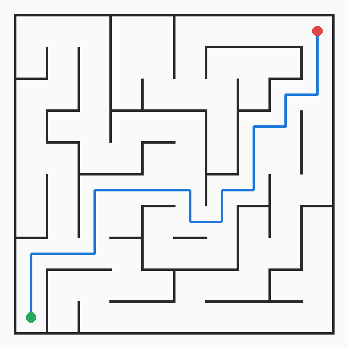
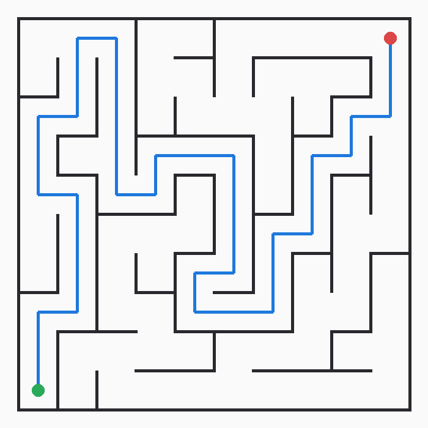

<div align="center">

# 迷宫自主探索与路径规划

**ROS 2 Humble · Gazebo 11 · TurtleBot3 Burger · 无地图自主探索**

[](https://docs.ros.org/en/humble/)
[](https://classic.gazebosim.org/)
[](https://www.python.org/)
[](LICENSE)

使用激光与位姿：随机 DFS 生成迷宫 → 边走边建图（贪心 / 随机 DFS + BFS 回溯）。

</div>

<p align="center">
  
</p>

<p align="center"><sub>seed=42 · 10×10 · 8 条环路：绿点起点，红点终点，蓝线为最短路（20 步）。由 <code>Maze.render_png</code> 生成。</sub></p>

## 核心特性

- **完备探索 + 最优冲刺** —— 探索靠贪心/随机 DFS 加 BFS 回溯，保证发现出口；冲刺用曼哈顿启发式 A\*，路径最短。
- **一条命令跑全套** —— `ros2 launch` 在启动时现场生成迷宫 `.world`，再拉起 Gazebo、机器人、算法节点与 Qt 控制台。
- **可复现** —— 迷宫、最短路、出生点全由 `seed/cols/rows/loops` 决定，换 seed 就是换一张迷宫。
- **自带看门狗** —— 3 s 内位移 < 0.05 m 判定卡死，把该边标记为墙并倒退 1 s 重规划，不会顶墙角顶到底。
- **可观测、可验证** —— `/map`、`/plan`、`/nav_status` 实时可视化；`verify_paths` 批量校验「A\* 步数 == BFS 步数」且不穿墙。

> 为什么不用像素级前沿探索：1 m 走廊里 3 m 激光会把空间看穿，未知区永远不与会观测的空闲区相邻，前沿集合恒为空。
> 所以本项目在 **1 m 格子图**上维护「这一格和邻居通不通」，用图搜索代替栅格搜索；位姿取 Gazebo 真值。

## 快速开始

```bash
# 依赖（Ubuntu 22.04 + ROS 2 Humble）
sudo apt install -y ros-humble-gazebo-ros-pkgs ros-humble-turtlebot3-gazebo \
                    python3-pyqt5 python3-pil

git clone https://github.com/<your-github-id>/run_maze.git
cd run_maze/runmaze                     # 这个目录才是 colcon 工作空间根
source /opt/ros/humble/setup.bash
colcon build --symlink-install && source install/setup.bash

ros2 launch maze_nav maze_explore.launch.py seed:=42
```

无图形界面（服务器 / WSL 无 WSLg）时加 `gazebo_gui:=false qt_gui:=false`。

启动后 Gazebo 里出现 10×10 迷宫、Burger 停在起点格心 `(0.5, 0.5)`；Qt 里占据栅格逐步扩展、轨迹延伸；日志打印

```
[INFO] [maze_explorer]: 扫描 (0, 0): {'E': True, 'N': False, 'W': True, 'S': True}
[INFO] [maze_explorer]: 探索 (0, 0) -> (0, 1)，已访问 1 格
...
[INFO] [maze_explorer]: 已到达终点（探索 25 格）
```

## 常用启动命令

以下省略前缀 `ros2 launch maze_nav`：

| 命令 | 用途 |
|---|---|
| `maze_explore.launch.py seed:=42` | **未知迷宫自主探索**（主线） |
| `maze_burger.launch.py seed:=42` | 已知地图 A\* 导航（对照组） |
| `maze.launch.py seed:=42` | 只生成并加载迷宫世界 |
| `burger_gui.launch.py` | 空世界 + 手动点选目标 |
| `burger.launch.py` / `burger_goal.launch.py` | 模型与雷达验证 / 里程计 P 控制 |

其它工具：

```bash
ros2 run maze_nav generate_maze --seed 42 --png        # 只生成 world + json + 预览图
ros2 run maze_nav verify_paths --seeds 200             # 批量校验 A* 最短性
```

## 主要参数

| 参数 | 默认 | 说明 |
|---|---|---|
| `seed` | `0` | 随机种子，同一 seed 永远同一张迷宫 |
| `cols` / `rows` | `10` / `10` | 格子数，终点自动取右下角格心 |
| `loops` | `8` | 额外打通的内墙数，>0 产生环路（多解） |
| `strategy` | `random` | `random` = 随机 DFS；`greedy` = 朝终点，步数更少 |
| `explore_all` | `false` | `true` = 先逛完整座迷宫再冲刺（回溯多，适合演示） |
| `gazebo_gui` / `qt_gui` | `true` | 无界面时置 `false` |

**话题**：订阅 `/scan`、`/gazebo/model_states`、`/nav_cancel`；发布 `/cmd_vel`、`/map`（0.1 m 占据栅格）、`/plan`（A\* 航点）、`/nav_status`（状态文本）。

## 实测结果

| 种子 | 尺寸 | loops | 墙段数 | BFS 步数 | A\* 步数 |
|---|---|---|---|---|---|
| 42 | 10×10 | 0 | 121 | 38 | 38 |
| 42 | 10×10 | 8 | 113 | 20 | 20 |
| 3 | 10×10 | 8 | 113 | 34 | 34 |

<p align="center">
  
  
</p>

- **A\* 最优性**：BFS 与 A\* 步数 100% 一致，`verify_paths` 批量校验通过。
- **探索效率**：seed=42 实跑 129 s 走完 25 格（约 4 s/格，0.35 m/s 限速 + 90° 转弯）；30 张完美迷宫全部走通，`greedy` 比 `random` 少走 34% 的格数。

## 目录结构

```
run_maze/
├── README.md
├── LICENSE
├── assets/                         # README 用图，可由 render_png 重新生成
└── runmaze/                        # colcon 工作空间根
    ├── run_maze.bash               # build + launch 一键脚本
    └── src/maze_nav/
        ├── launch/                 # 6 个 launch：explore / burger / maze …
        ├── worlds/empty.world
        └── maze_nav/
            ├── maze.py             # 迷宫生成 + BFS/A* + SDF/JSON/PNG（纯 Python）
            ├── explorer.py         # 未知迷宫探索（核心）
            ├── maze_navigator.py   # 已知地图 A* 导航（对照组）
            ├── go_to_goal.py       # 里程计 P 控制
            ├── generate_maze.py    # 命令行生成工具
            ├── qt_goal_gui.py      # Qt 控制台（PyQt5）
            └── verify_paths.py     # A* 最短性校验
```


## 许可

基于 **Apache License 2.0** 开源，见 [LICENSE](LICENSE)。
机器人模型与插件来自 [turtlebot3](https://github.com/ROBOTIS-GIT/turtlebot3)（Apache-2.0），仿真器为 [Gazebo](https://classic.gazebosim.org/)，中间件为 [ROS 2 Humble](https://docs.ros.org/en/humble/)。
项目源自课程《机器人感知与控制综合实践》（课程代码 (2026-2027-1)-S0610350-02）方向 1「地老鼠走迷宫系统的开发」。

<div align="center">

Made with ROS 2 + Gazebo · 2026

</div>
